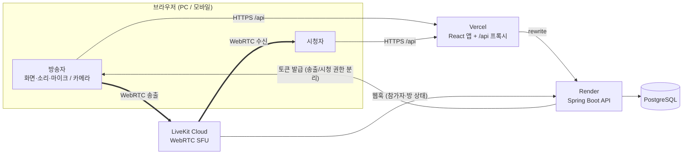

# Live — 브라우저만으로 하는 실시간 라이브 방송

> 설치 없이 PC에선 **화면·소리·마이크**를, 휴대폰에선 **카메라·마이크**를 실시간으로 송출하고, 다른 기기에서 1초 미만 지연으로 시청하는 웹 서비스

## 🔗 서비스 주소
- 웹: **https://live-six-gamma.vercel.app**
- API 문서(Swagger): https://live-backend-42fg.onrender.com/swagger-ui/index.html
- 저장소: https://github.com/jjuny-won/live

> 백엔드는 무료 호스팅이라 한동안 접속이 없으면 잠들어, **첫 접속에 30초~1분**이 걸릴 수 있습니다. 첫 화면이 느리면 잠시 후 새로고침해 주세요.

## 🔑 테스트 계정
| 구분 | 이메일 | 비밀번호 |
|---|---|---|
| 방송자 | streamer@demo.test | demo1234! |
| 시청자 | viewer@demo.test | demo1234! |

로그인 화면의 **[테스트 계정으로 시작]**(방송자) / **[시청자 테스트 계정으로 시작]** 버튼을 누르면 바로 로그인됩니다. 시청은 로그인 없이도 가능합니다.

## ✅ 기능 확인 방법 (5분)
> 권장 환경: PC는 **Chrome/Edge 최신**, 모바일은 iOS Safari / Android Chrome. 카메라·마이크·화면 공유 권한을 허용해 주세요.

1. **로그인**: [테스트 계정으로 시작] 클릭
2. **방송 등록**: [방송 만들기] → 제목 입력 → 저장 (내 방송 목록에서 수정·삭제 가능)
3. **PC 송출**: [방송 시작] → 공유할 화면/탭 선택 → **"오디오 공유" 체크** → 마이크 켜기
4. **시청**: 다른 기기(또는 시크릿 창)에서 서비스 주소 접속 → 홈의 LIVE 방송 클릭 → [소리 켜기]
5. **모바일 송출**: 휴대폰으로 접속 → 테스트 계정 로그인 → 방송 만들기 → 방송 시작 (전/후면 카메라 전환 가능)
6. **권한 확인**: 시청자 계정으로 로그인해 방송자의 방송 수정 주소에 접근 → 권한 없음(403) 안내
   - Swagger로도 확인 가능: [`backend/README.md`](backend/README.md#swagger로-권한-확인-3분)

> macOS에서 "시스템 전체 소리" 공유는 Chrome 141+ & macOS 14.2+ 에서 가능합니다. 그 이하 환경에서는 **Chrome 탭을 공유**하면 탭 소리가 송출됩니다.

## 📋 요구사항 충족 현황
| 요구사항 | 상태 | 구현 위치 |
|---|---|---|
| PC 라이브: 화면 공유 | ✅ | `frontend/src/features/studio/PcStudio.tsx` |
| PC 라이브: 소리 공유 | ✅ | 〃 (`systemAudio: 'include'`), `useLiveSession.ts` (`ScreenShareAudio` 트랙) |
| PC 라이브: 마이크 송출 | ✅ | 〃, `AudioMeter.tsx`(입력 레벨 표시) |
| 모바일 라이브: 카메라+마이크 | ✅ | `frontend/src/features/studio/MobileStudio.tsx`, `device.ts`(PC/모바일 자동 판별) |
| 방송 등록·조회·수정·삭제 | ✅ | `backend/src/main/java/com/jjuny/live/broadcast/`, `frontend/src/pages/` |
| 실시간 시청 | ✅ | `frontend/src/features/watch/LivePlayer.tsx`, `pages/WatchPage.tsx` |
| 회원가입·로그인·로그아웃 (JWT + Refresh 쿠키) | ✅ | `backend/src/main/java/com/jjuny/live/auth/` |
| 방송 소유자 권한 (타인 수정·삭제·송출 403) | ✅ | `BroadcastService#checkOwner`, `live/LiveTokenService.java` (시청 토큰 `canPublish=false`) |
| 방송 상태·시청자 수 반영 (LiveKit 웹훅, 서명 검증) | ✅ | `live/LiveKitWebhookController.java`, `LiveKitWebhookService.java` |
| 채팅 | ➖ | 미구현 (시청 화면에 자리만 마련) |
| 도네이션 | ➖ | 미구현 |
| 녹화·다시보기 | ➖ | 미구현 |

## 🏗 아키텍처

- 미디어는 직접 중계하지 않고 **LiveKit(WebRTC SFU)** 에 맡겨 지연을 1초 미만으로 유지합니다.
- 백엔드는 인증·방송 관리와 **권한이 다른 LiveKit 토큰 발급**(방송자만 publish 가능)을 담당합니다.
- 프론트는 `/api`를 같은 출처로 호출하고 Vercel이 백엔드로 프록시하므로, Refresh 쿠키가 서드파티 쿠키 차단의 영향을 받지 않습니다.

## 🛠 기술 스택
- **Frontend**: React 19, TypeScript, Vite, Tailwind CSS, TanStack Query, livekit-client
- **Backend**: Java 21, Spring Boot 3.5, Spring Security(JWT), JPA, PostgreSQL 17, Flyway, springdoc-openapi
- **Media**: LiveKit Cloud (WebRTC SFU, TURN)
- **Infra**: Vercel(프론트), Render(백엔드 Docker + PostgreSQL, [`render.yaml`](render.yaml))
- **Test**: JUnit 5, Testcontainers(PostgreSQL) — 인증, 소유자 권한, 토큰 권한, 웹훅 서명 검증

## 💻 로컬 실행
```bash
cp .env.example .env   # LIVEKIT_URL, LIVEKIT_API_KEY, LIVEKIT_API_SECRET 입력
docker compose up -d   # PostgreSQL
cd backend && ./gradlew bootRun          # http://localhost:8080
cd frontend && npm install && npm run dev # http://localhost:5173
```
- LiveKit 키 없이도 실행됩니다(송출·시청 토큰 API만 503). 목업 API로 화면만 보려면 `npm run dev:mock`.
- 휴대폰으로 로컬 테스트할 때는 카메라 권한에 HTTPS가 필요하므로 `cloudflared tunnel --url http://localhost:5173`을 사용합니다.
- 백엔드 테스트: `cd backend && ./gradlew test` (Docker 필요)
- 자세한 내용: [`backend/README.md`](backend/README.md), [`frontend/README.md`](frontend/README.md), API 계약 [`docs/API.md`](docs/API.md)

## 🤖 AI 개발 도구 활용
- **Claude Code**로 설계 문서(요구사항별 기술 비교, API 계약, 결정 기록 — [`docs/`](docs/))를 먼저 작성하고, 이를 기준으로 백엔드·프론트엔드를 **git worktree로 분리한 별도 세션**에서 병렬 개발했습니다.
- API 계약(`docs/API.md`)을 두 세션의 공통 기준으로 삼아, 계약이 바뀌면 문서를 먼저 고치고 반대편이 맞추는 방식으로 통합했습니다.
- 권한·토큰·웹훅 서명 등 보안 관련 로직은 통합 테스트(Testcontainers)로 검증하고, 배포 설정(Dockerfile, Render Blueprint, Vercel 프록시)도 AI와 함께 작성했습니다.

## 📌 알려진 제약 / 확장 계획
- 모바일 웹은 브라우저 정책상 화면 공유가 불가합니다(요구사항대로 카메라+마이크 송출).
- Firefox·Safari는 화면 소리 공유를 지원하지 않아 PC는 Chrome/Edge를 권장합니다.
- 무료 호스팅 특성상 백엔드 첫 접속이 느릴 수 있습니다.
- 확장 계획: 채팅(LiveKit Data 메시지), 녹화·다시보기(LiveKit Egress), 대규모 시청 시 Egress HLS + CDN 병행.
