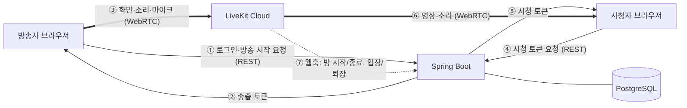
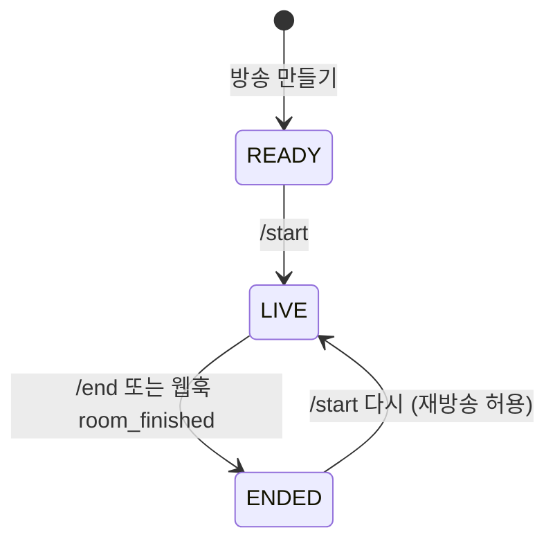
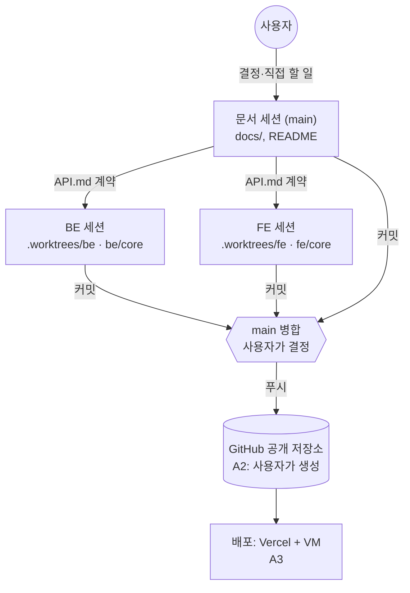

# 전체 흐름 한눈에 보기

> 이 프로젝트가 **어떻게 돌아가고**(서비스 흐름), **어떻게 만들어지고**(작업 흐름), **지금 어디쯤인지**(현재 위치)를 한 장으로 정리했습니다.
> 마지막 갱신: 2026-11-14 13:07

---

## 1. 서비스는 이렇게 돌아간다

### 1-1. 등장인물 4개

| 구성 요소 | 하는 일 | 비유 |
|---|---|---|
| **프론트(React)** | 화면. 카메라·화면을 잡아서 보내고, 받은 영상을 보여 줌 | 방송국 스튜디오 + TV |
| **백엔드(Spring Boot)** | 회원·방송 정보 저장, **"너는 송출해도 돼 / 시청만 해"라는 출입증(토큰) 발급** | 매표소 |
| **LiveKit Cloud(SFU)** | 영상·소리를 실제로 받아서 시청자들에게 나눠 줌 | 방송 송신탑 |
| **PostgreSQL** | 회원, 방송, (나중에) 채팅·후원·녹화 기록 | 장부 |

핵심: **영상은 백엔드를 거치지 않는다.** 백엔드는 출입증만 주고, 영상은 브라우저 ↔ LiveKit 사이로만 흐른다.



### 1-2. 방송자 한 번의 흐름

| 단계 | 화면(FE 경로) | 호출하는 API | 일어나는 일 |
|---|---|---|---|
| 1. 로그인 | `/login` | `POST /api/auth/login` 또는 `/test-login` | Access 토큰(30분) + Refresh 쿠키(14일) 받음 |
| 2. 방송 만들기 | `/broadcasts/new` | `POST /api/broadcasts` | DB에 방송 생성, 상태 `READY` |
| 3. 스튜디오 입장 | `/studio/:id` | — | PC면 화면공유 UI, 휴대폰이면 카메라 UI로 자동 분기 |
| 4. 방송 시작 | 〃 [방송 시작] 버튼 | `POST /api/broadcasts/{id}/start` | 백엔드가 **소유자인지 확인** → 송출 토큰 발급, 상태 `LIVE` |
| 5. 송출 | 〃 | (LiveKit SDK) | `getDisplayMedia`(화면+소리) + `getUserMedia`(마이크/카메라) → 트랙별로 LiveKit에 publish |
| 6. 방송 종료 | 〃 [종료] | `POST /api/broadcasts/{id}/end` | 상태 `ENDED`, LiveKit 방 닫힘 |

### 1-3. 시청자 한 번의 흐름

| 단계 | 화면 | API | 일어나는 일 |
|---|---|---|---|
| 1. 목록 | `/` | `GET /api/broadcasts?status=LIVE` | LIVE 방송이 위에, 시청자 수 표시 |
| 2. 입장 | `/live/:id` | `POST /api/broadcasts/{id}/viewer-token` | 로그인 안 해도 됨(B3). 토큰은 `canPublish=false` → 미디어 서버 수준에서 송출 불가 |
| 3. 시청 | 〃 | (LiveKit SDK) | 방송자 트랙을 구독, [소리 켜기] 버튼 누르면 소리 재생(자동재생 정책) |
| 4. 방송 끝남 | `/live/:id/ended` | — | 방송자가 끝내면 종료 화면으로 |

### 1-4. 상태가 바뀌는 길 (웹훅)

브라우저가 그냥 꺼져도(종료 버튼 안 누르고) 목록에서 LIVE가 풀려야 한다. 그래서 LiveKit이 백엔드에 알려 준다.



- `participant_joined / left` 웹훅 → 시청자 수 갱신
- 로컬 개발 중에는 LiveKit이 내 PC로 웹훅을 못 보냄 → `cloudflared` 터널 필요(배포 후엔 해결)

### 1-5. 권한(소유자 확인)은 두 겹

1. **API 레벨**: 수정·삭제·시작·종료 시 `방송.owner == 로그인 사용자` 아니면 403 `BROADCAST_FORBIDDEN`
2. **미디어 레벨**: 송출 토큰은 소유자에게만. 시청 토큰은 `canPublish=false`라 남의 방에 영상을 올릴 수 없음

→ 제출 폼 "인증·인가" 근거에 그대로 쓰는 문장.

---

## 2. 작업은 이렇게 굴러간다



| 누가 | 어디서 | 무엇을 |
|---|---|---|
| **사용자** | 브라우저·터미널 | 결정(B 항목), 가입·키 발급·결제(A 항목), 병합·푸시, 실기기 테스트, 제출 |
| 문서 세션 | `main` 메인 폴더 | 문서·학습 노트, 진행 표, 하루 2번(12시·24시) 현황 갱신 |
| BE 세션 | `.worktrees/be` (`be/core`) | `backend/`, docker-compose |
| FE 세션 | `.worktrees/fe` (`fe/core`) | `frontend/` |

규칙 3개만 기억하기
1. BE·FE가 만나는 지점은 **`docs/API.md` 하나**. 바뀌면 양쪽에 알린다.
2. 브랜치는 기능이 끝나면 `main`에 합친다. 합치기·푸시는 사용자가 한다.
3. 비밀값(LiveKit 키 등)은 `.env`에만, 커밋 금지.

---

## 3. 지금 어디쯤인가 (11/14 13:07 기준)

```
일정:  D0 준비 ─ D1 BE골격 ─ D2 방송CRUD ─ D3 FE골격 ─ D4 스튜디오·첫배포 ─ D5 모바일 ─ D6 웹훅 ─ D7 동결 ─ D8 채팅(오늘)
코드:  ✅        ✅          ✅            ✅          🟡(로컬 송출✅, 배포 X) 🔴(실기기 X) 🔴(코드✅, 실검증 X) 🔴(배포 X) 🔴(미착수, 배포 먼저)
병합:  BE·FE 모두 main에 병합 완료 (11/7 13:41~13:53)
```

**코드는 일정보다 빠르고, 이제 전부 `main` 한 곳에 모였다.** FE는 실제 백엔드 계약(401 두 종류, 409·503, ENDED 재시작)까지 맞춰 둔 상태.
**11/9 로컬에서 LiveKit Cloud로 처음 PC 송출 → 시크릿 창 시청까지 성공했다.** 이제 남은 장애물은 '밖으로 내보내기'(저장소·서버·도메인)이고 전부 사용자 쪽 할 일:

| 막힌 것 | 왜 막히나 | 풀리면 |
|---|---|---|
| ~~A1 LiveKit 키~~ | 11/9 해결 (키 연결·로컬 송출/시청 확인) | — |
| ~~Node 20.19 미만~~ | 11/8 해결 (v22.19.0) | — |
| 🔴 **B1 이름 미정** | GitHub 저장소(A2, **11/9 기한 경과**, 11/14 13:07 현재 remote 없음)를 못 만듦 | 푸시·배포 준비 |
| 🔴 **B4 호스팅·B5 도메인 미정** | VM·도메인(A3, **11/10 기한 경과**, 11/14 13:07 현재 미정)을 못 정함 | 첫 배포, 웹훅(시청자 수) 확인 |
| 🔴 **배포 없음** | 휴대폰에서 HTTPS로 접속할 주소가 없어 A5 실기기 테스트(**11/11 기한 경과**)와 11/12 웹훅 실검증을 못 함. 11/13 필수 기능 동결도 배포 환경 점검 없이 지나감. 오늘(11/14) 채팅도 미착수, A4(녹화 스토리지, 오늘 기한)도 ⬜ — 선택 기능 전체가 밀리는 중 | iPhone Safari·Android Chrome 송출/시청 확인, 동결, 선택 기능 착수 |
| ~~브랜치 미병합~~ | 11/7 해결 | — |

### 다음 순서 (이대로만 하면 됨)

1. ~~Node 다시 설치~~ → 완료 (v22.19.0)
2. ~~LiveKit Cloud 가입·키 발급~~ → 완료 (11/9 연결 확인)
3. ~~로컬에서 처음으로 끝까지 해 보기~~ → 완료 (11/9). 시청 지연 수치 측정은 PROGRESS TODO에 남음
4. 이름(B1) 정하고 GitHub 저장소 생성·푸시(A2, **11/9 기한 지남**) ← **지금 할 일** — `live`(가칭) 그대로 써도 됨
5. 호스팅(B4)·도메인(B5) 정하고 VM·도메인 준비(A3, **11/10 기한 지남**) → 첫 배포(**11/10 목표에서 4일 지연**, 마감까지 5일 — 선택 기능을 줄이더라도 배포가 먼저) ← **지금 할 일**
6. 배포 주소로 휴대폰 실기기 테스트(A5, 기한 지남) + LiveKit 웹훅 URL 등록 후 시청자 수 확인(D6, 11/12 기한 지남) → 필수 기능 동결(11/13, 기한 지남)
7. 그다음 선택 기능: 채팅(11/14, 미착수) → 녹화(A4 스토리지 필요, 오늘 기한) → 도네이션. 마감까지 5일이라 녹화·도네이션은 빼는 것도 검토

> 3번에서 막히는 곳이 생기면 그게 바로 공부할 지점입니다. 학습 노트(`docs/study/`)와 연결해서 정리해 드립니다.
